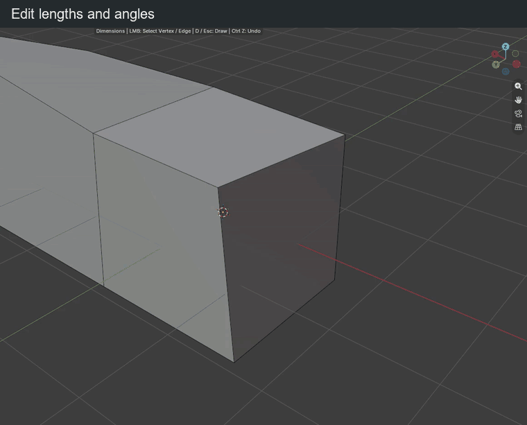

# Dimensions

Click **Dimensions** in **N > BagaCAD**, or press **D** while drawing, then select a vertex or an edge. Near an endpoint, the vertex takes priority. A single selected or active element may be picked automatically.

Labels show the edge length, nearby parallel distances and angles. Lengths follow the scene units; angles use degrees.

## Change a value

<figure class="demo">
  
  <figcaption>Edit the dimensions around a selected vertex; connected faces follow.</figcaption>
</figure>

| Key or gesture | Action |
| --- | --- |
| Click an edge | Select the edge to measure and edit |
| Click a value | Highlight it in blue and type a replacement |
| Drag a value left / right | Decrease / increase it |
| Release the drag | Confirm the change |
| Ctrl while dragging | Use the configured length or angle increments |
| Shift while dragging | Adjust ten times more finely |
| Enter / click during input | Confirm typed input |
| Esc / right click during input | Cancel the edit |
| Ctrl + A during input | Select the whole value |
| Ctrl + V during input | Paste a value |
| Backspace during input | Delete a character |

Lengths accept units such as `mm`, `cm`, `m`, `ft` and `in`. Angles accept values from −360° to 360°. Typed values do not use drag rounding.

## Fixed end and locks

| Key or gesture | Action |
| --- | --- |
| Tab outside input / click the support icon | Switch the fixed endpoint |
| Hover a value | Reveal its padlock |
| Click the padlock | Lock / unlock that dimension |

A length edit moves the free endpoint along the edge. A parallel distance edit translates the edge. Angle edits try to slide connected endpoints along neighboring directions, changing the edited length when needed to limit distortion.

Locked values are kept while neighboring geometry adjusts. If constraints conflict, cancel or unlock a value. Locks last only while Dimensions is active; leaving the mode clears them.

## Undo and return

| Key or gesture | Action |
| --- | --- |
| Ctrl + Z during input or a drag | Cancel the current preview |
| Ctrl + Z outside input | Undo a validated change |
| Backspace outside input | Deselect the edge |
| Backspace during a drag | Cancel the preview |
| Right click outside input | Deselect the edge |
| D / Esc outside input | Return to drawing |
