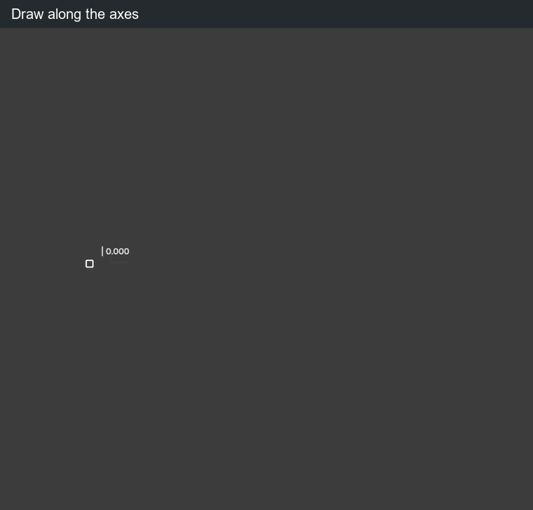
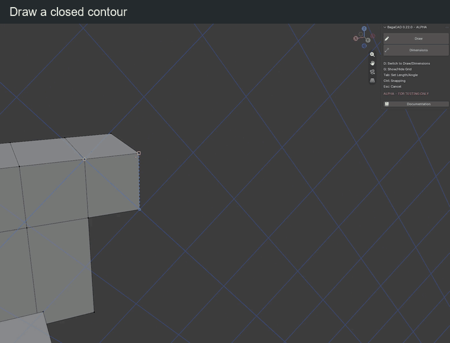

# Draw

Place a start point, then add segments. On a face, hold Ctrl when clicking to draw instead of extruding; keep away from a guide handle.

| Key or gesture | Action |
| --- | --- |
| Left click | Place the start point or confirm the next segment |
| Right click | Start a new chain |
| Ctrl + click inside a face | Start drawing on the face |
| X / Y / Z | Lock the corresponding axis; press again to release |
| Shift + X / Y / Z | Lock to YZ / XZ / XY; press again to release |
| Type digits | Set the active length or angle value |
| Tab | Switch between length and angle input |
| Click / Enter | Confirm the segment |
| Backspace | Delete a digit; outside input, cancel the unfinished chain |
| Ctrl, held | Disable mesh, grid and guide snapping; release to restore snapping |
| Ctrl + Z | Undo a validated edit; discard any unfinished guide/grid setup first |
| Esc | Clear input, setup or selection; otherwise finish the tool |
| Enter without input or selection | Finish the tool |

## Precision

<figure class="demo">
  
  <figcaption>Use the coloured axes to align successive segments.</figcaption>
</figure>

A typed length fixes distance while the direction follows the mouse. A typed angle fixes the angle while the length changes. Enter both to fix both. Tab alone selects a field without locking it.

Drawing snapping is on by default. Hold Ctrl to disable it; release Ctrl to restore it. Axis/plane locks and typed values still apply while Ctrl is held.

Snap targets include vertices, midpoints, edges, faces, construction guides, temporary reference points and grid nodes ([Guides & grid](guides-grid.md)). With a fixed length, any snap target can choose the direction; the segment keeps its entered length. Displayed measurements follow the scene units. Drawing input uses Blender units; angles use degrees.

In empty space without a snap, grid plane or explicit constraint, the first point uses a view-parallel plane through the 3D cursor. Each following segment uses a view-parallel plane through its starting point instead.

For circles, rectangles and parallel edges, see [Shapes & offsets](shapes.md).

## Faces

<figure class="demo">
  
  <figcaption>Close the contour to create a face.</figcaption>
</figure>

Close a flat contour to fill it. Draw between face borders to cut a face. Crossings split edges; overlapping segments merge.

To fill a missing flat region, retrace one of its border edges. Existing coplanar faces are not covered. A diagonal across an empty square can fill both sides.

## Erase and extend edges

| Key or gesture | Action |
| --- | --- |
| Hold Shift + right mouse, then sweep | Erase visible edges under the cursor |
| Release right mouse or Shift | End the stroke; one undo step for the whole sweep |
| Esc / Ctrl + Z during the stroke | Cancel the sweep and restore the mesh |
| Hold Alt over an edge | Preview extension from the endpoint nearest the cursor |
| Alt + left click on the preview | Extend to the first real vertex, edge or face target |
| Release Alt | Hide the extension preview |

Erasing B–C in A–B–C–D keeps A–B and C–D. A divider between coplanar faces is dissolved while preserving the surface. Erasing a boundary or an edge between non-coplanar faces also removes its attached faces.

Extension joins the target in 3D; a screen-only crossing is not enough. Inside a face plane it targets real boundaries; a transverse arrival into a face makes a local cut. Without a visible target, clicking does nothing.

**Alt priority:** a hovered guide moves first; otherwise an edge can extend, while a face interior keeps coplanar extrusion. In Rectangle, Alt centres the shape.

## Navigation

| Key or gesture | Action |
| --- | --- |
| Middle mouse / Shift + middle mouse / wheel | Orbit / pan / zoom with the default Blender keymap |
| Numpad during a segment | Enter numbers |
| Numpad before the first point | Use Blender view shortcuts |

BagaCAD shortcuts can be changed in the [preferences](shortcuts.md); navigation uses Blender's keymap.
