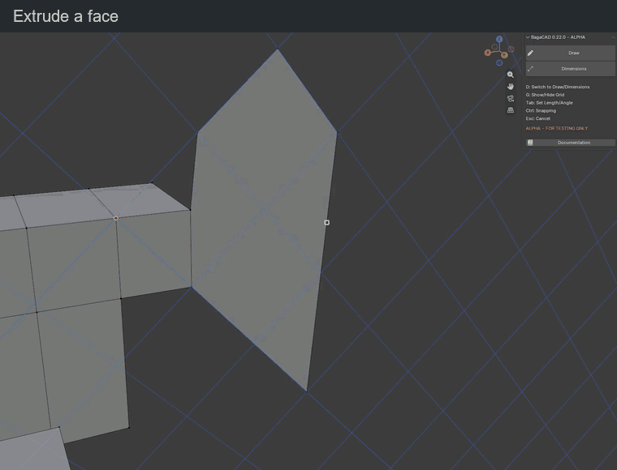
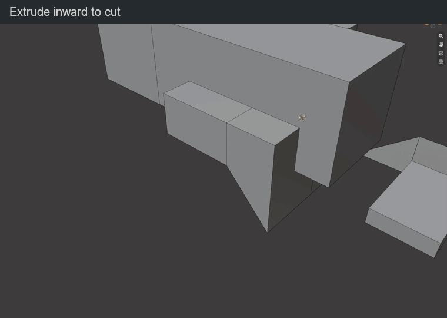

# Extrude

Hover inside a face with no segment in progress. A light overlay marks the extrusion target. Start the extrusion, move the mouse, then confirm. The face moves along its normal.

| Key or gesture | Action |
| --- | --- |
| Click a highlighted face | Start an extrusion preview |
| Move the mouse | Adjust the extrusion distance |
| Type a distance | Set an exact distance in Blender units |
| Minus | Change the direction of the typed distance |
| Backspace | Correct typed distance; without input, cancel the preview |
| Click / Enter during the preview | Confirm the extrusion |
| Esc / right click / Ctrl + Z during the preview | Cancel it and restore the original mesh |
| Ctrl + Z after confirmation | Undo the whole extrusion in one step |

Undo affects the latest validated edit. Cancelling a preview leaves earlier edits in the local history; press Ctrl + Z again to undo the previous edit. An empty history does nothing. After leaving BagaCAD, Blender handles undo.

<figure class="demo">
  
  <figcaption>Extrude the new face into a volume.</figcaption>
</figure>

## Several faces

| Key or gesture | Action |
| --- | --- |
| Shift + click | Add / remove a face from the selection |
| Plain click on a selected face | Extrude the selection |
| Enter with a selection | Extrude along the last selected face's normal |
| Alt + click | Replace the selection with connected coplanar faces and extrude them |
| Esc / right click before extrusion | Clear the selection |

For non-coplanar selected faces, the group moves in one common direction: the normal of the last selected face. Coplanar selection spreads only through shared edges, not corner contacts or detached faces.

## Snapping

Height snapping is off by default and is active only while Ctrl is held.

| Key or gesture | Action |
| --- | --- |
| Hold Ctrl and aim at a vertex, midpoint, edge or face | Place the extruded face plane through that snap point |
| Hold Ctrl during extrusion | Enable height snapping; release for free movement |
| Orbit / pan / zoom | Change the view while keeping the preview active |

The face still moves only along its extrusion direction. A typed distance takes priority over snapping.

## Result

<figure class="demo">
  
  <figcaption>Push a face inward to remove material from the same mesh.</figcaption>
</figure>

Outward extrusion can fuse with volumes in the same mesh. Inward extrusion can make a pocket or a through-hole. The exact boolean calculation happens when you confirm and remains one undo step.

An isolated surface keeps a bottom and becomes a volume. Other objects remain separate.
