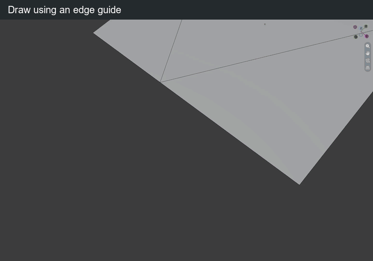

# Guides & grid

## What is a construction guide?

A **construction guide** is a drawing reference used to position or align geometry. It is not an edge or face in the mesh and is not rendered. In BagaCAD, construction guides include XYZ references, infinite edge lines and the construction grid.

An **XYZ reference** has one origin and three perpendicular axes. An **edge guide** extends an edge direction infinitely in both directions. A **grid** provides evenly spaced snap points on a plane. They complement the mesh snaps instead of replacing them.

Guides and temporary references also remain available during [circles, rectangles and offsets](shapes.md). The soft plane indicator around the shape cursor does not add snap points.

Guides stay available between segments during the active tool session. They are not saved as scene objects. The grid has its own show/hide command and remembers its last setup for that session.

| Key or gesture | Action |
| --- | --- |
| Hover a vertex or edge midpoint for 2 s | Add an XYZ construction guide |
| Hover an edge away from its midpoint and ends for 2 s | Add an infinite guide along that edge |
| A on a vertex, then click another vertex | Add a guide through both vertices |
| Hold Alt over a guide, then move | Move the guide; release to confirm |
| Hold Shift over an XYZ axis, then aim | Rotate the whole XYZ reference around its fixed origin; release to confirm |
| X / Y / Z while holding Shift to rotate XYZ | Lock rotation around that initial local guide axis; repeat to unlock |
| Esc / right click during a transformation | Cancel the preview |
| R | Remove the last XYZ or edge guide |
| Shift + R | Clear XYZ/edge guides and temporary references; the grid is unchanged |

Moving an XYZ reference moves its three axes together. An edge guide keeps its direction and can snap through a chosen point. Guide intersections must meet in 3D; a crossing visible only on screen is not a snap.

<figure class="demo">
  
  <figcaption>Use an edge extension as a guide for a new contour.</figcaption>
</figure>

*This clip uses an earlier development build; use the shortcuts listed above.*

## What is a temporary reference point?

A **temporary reference point** remembers a position briefly to help align the next segment. It does not create permanent construction geometry. Its projections offer XYZ directions and the extensions of edges meeting at that point. Dotted links show which reference supplies the snap.

| Key or gesture | Action |
| --- | --- |
| Hover a vertex for 0.15 s, then move away | Remember it and use its temporary projections |
| Hover a guide/guide or guide/edge intersection for 0.15 s | Remember that intersection as a temporary reference |
| Acquire a third temporary point | Replace the oldest of the two remembered points |
| Confirm a segment / start a new chain / clear guides | Clear the temporary references |

Two temporary points can work together, including intersections with construction guides. Following a temporary axis can also snap to its intersection with a plane through the other point: XY, YZ, XZ or an incident face plane. Those planes stay invisible; a violet dotted link identifies the relation.

A short hover acquires a temporary reference; continuing the hover can create a construction guide where supported. The four hover delays are editable in [preferences](shortcuts.md).

## Construction grid

| Key or gesture | Action |
| --- | --- |
| G | Show / hide the remembered grid; on first use, create XY at the 3D cursor |
| Shift + G | Place or reorient the grid in two clicks: origin, then X direction |
| G while choosing the second direction point | Toggle using the measured segment length as cell size |
| Hold Ctrl at the second direction click | Use that segment length as cell size |
| Ctrl + G | Set cell size by measuring a segment or typing a number, then Enter |
| Alt + G | Place and align the grid to the hovered face |
| Shift + X / Y / Z, no segment active | Orient a world grid to YZ / XZ / XY |
| Esc / right click during setup | Cancel setup and restore the previous grid |

G normally hides the grid; during direction setup it controls the cell-size option instead. Hiding and showing it preserves its origin, orientation and cell size. R and Shift + R do not hide it.

The grid snaps only to line intersections, not cell centers or side midpoints. Its default step is 0.1 Blender unit. Mesh, guide and temporary-reference snaps remain available with the grid active.

While drawing, snapping to these references and grid nodes is enabled by default. Hold Ctrl to disable snapping; the grid remains a drawing plane without rounding to nodes. Grid setup and guide editing keep their own point picking.

During an XYZ rotation, X/Y/Z refer to the guide frame at the start of the gesture, including tilted guides. The origin and the selected rotation axis stay fixed; all three axes rotate together. If the grabbed axis is itself the rotation axis, the next local axis supplies the aiming direction. A target on the rotation axis leaves the last valid orientation unchanged.

Hold Alt over any XYZ, edge or custom construction guide to move it. Snapping is active immediately; release Alt to confirm, or use Esc / right click / Backspace to cancel. Over a guide, this takes priority over coplanar-face selection. Away from guides, Alt keeps its face-selection behavior.
